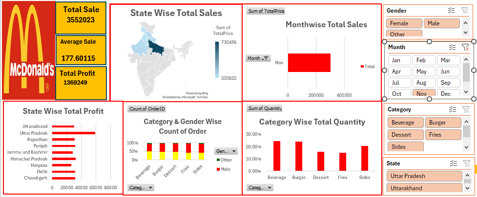

# McDonald's Sales & Profit Performance Dashboard

**🌟 Project Overview**

The McDonald's Sales & Profit Performance Dashboard is an Excel-based data analytics project designed to analyze sales revenue, profitability, order volume, and product quantity across Indian states, product categories, customer demographics, and months.

The dashboard transforms raw order and sales data into an interactive visual report that helps stakeholders monitor regional performance, evaluate profitability by state, track monthly sales patterns, and compare demand across menu categories[cite: 7].

Interactive slicers allow users to filter the dashboard by `Gender` (`Female`, `Male`, `Other`), `Month` (`Jan`–`Dec`), `Category` (`Beverage`, `Burger`, `Dessert`, `Fries`, `Sides`), and `State` (such as `Uttar Pradesh` and `Uttarakhand`), making it easy to explore specific segments[cite: 7].

**📊 Business Problem**

Quick-service restaurant and retail teams need clear visibility into how total sales, average order value, and profit vary across states, customer genders, and menu categories[cite: 7].

Reviewing raw transaction tables manually makes it difficult to spot top-performing states, compare category order share, or slice performance by month and customer segment[cite: 7].

This project addresses that challenge by bringing key sales and profit metrics together with interactive charts and slicers in a single dashboard[cite: 7].

**🎯 Key Objectives**

1. Monitor overall sales, average order value, and profit using key performance indicators (KPIs).
2. Visualize geographic sales distribution across Indian states (`State Wise Total Sales` map).
3. Track monthly sales performance (`Monthwise Total Sales`, e.g., `Nov` in the active view).
4. Compare profit performance across states (`State Wise Total Profit` across states such as Uttar Pradesh, Uttarakhand, Rajasthan, Punjab, Jammu and Kashmir, Himachal Pradesh, Haryana, Delhi, and Chandigarh).
5. Analyze order counts across product categories and customer genders (`Category & Gender Wise Count of Order`).
6. Evaluate quantity share across menu categories (`Category Wise Total Quantity` for Beverage, Burger, Dessert, Fries, and Sides).
7. Enable interactive filtering using `Gender`, `Month`, `Category`, and `State` slicers[cite: 7].

**📁 Data Source**

**Source:** McDonald's Regional Sales & Order Dataset (included in the Excel workbook)[cite: 7].

**📝 Tools and Technologies**

1. **Microsoft Excel** - Data preparation, KPI summary cards, PivotTables, PivotCharts, slicers, and dashboard layout.
2. **Excel Formulas & Aggregations** - Calculation of total sales, average sale, total profit, order counts (`Count of OrderID`), and quantity (`Sum of Quantity`).
3. **Excel Visuals & Slicers** - KPI cards, map visualization, bar charts, 100% stacked column chart, column chart, and interactive slicers[cite: 7].

**🚀 Key Performance Indicators (KPIs)**

The dashboard highlights three primary KPIs:

1. **Total Sale:** 3,552,023
2. **Average Sale:** 177.60115
3. **Total Profit:** 1,369,249[cite: 7]

**📈 Dashboard Visualizations**

**✅ Conclusion**

The dashboard supports data-driven business decisions by helping teams identify high-revenue and high-profit states, monitor monthly sales trends, understand category demand and gender order patterns, and filter performance across key operational dimensions[cite: 7].